  

> [!NOTE]
> 📌 **Engineering Mindset:** *"Understand the task. Reason what's next. Make it happen."*  
> Exploring autonomous AI agents, real-time voice streaming, and cybersecurity defense. Always learning, solving real problems, and turning ideas into hardened, working systems.

---

### 📖 About Me &amp; Engineering Focus

<table>
  <tr>
    <td width="50%" valign="top">
      <h4>🎓 Academic Foundation</h4>
      <ul>
        <li><b>Institution:</b> Muthayammal Engineering College, Rasipuram</li>
        <li><b>Degree:</b> B.E. Computer Science &amp; Engineering (Cyber Security)</li>
        <li><b>Batch:</b> 2023 – 2027 (Final Year)</li>
        <li><b>Location:</b> Salem, Tamil Nadu, India</li>
        <li><b>Core Focus:</b> Network Defense, Threat Modeling, Cryptography, Secure Software Architecture</li>
      </ul>
    </td>
    <td width="50%" valign="top">
      <h4>💼 Industry &amp; Experience</h4>
      <ul>
        <li><b>Role:</b> Junior Software Engineer Intern</li>
        <li><b>Company:</b> <a href="https://elverve.com">Elverve Technologies</a> (Coimbatore, TN)</li>
        <li><b>Focus:</b> Autonomous AI Agent Orchestration, Deterministic Tool Calling, Real-Time Voice AI (Gemini Live / Pipecat)</li>
        <li><b>Methodology:</b> First-principles reasoning, log verification, zero-trust state boundaries</li>
      </ul>
    </td>
  </tr>
</table>

---

### 🛠️ Tech Stack &amp; Engineering Tooling

<table>
  <tr>
    <td width="33%" valign="top">
      <b>⚡ AI &amp; Agentic Systems</b>
        
      • LangGraph / State Machines 
      • Gemini Live (Voice AI) 
      • Pipecat Orchestration 
      • Neo4j (Knowledge Graphs) 
      • Qdrant (Vector Embeddings) 
      • RAG &amp; Dense Retrieval
    </td>
    <td width="33%" valign="top">
      <b>⚙️ Backend &amp; Platform</b>
        
      • Python / FastAPI 
      • Microsoft Azure (AI Foundry) 
      • Docker Containerization 
      • Redis Caching &amp; Queues 
      • Linux Administration 
      • Git Version Control
    </td>
    <td width="33%" valign="top">
      <b>🛡️ Security &amp; Core</b>
        
      • AST Static Analysis 
      • Network Fundamentals (Cisco) 
      • Android Security (EC-Council) 
      • Zero-Trust Credential Masking 
      • C / C++ / Java / JavaScript 
      • Problem Solving &amp; DSA
    </td>
  </tr>
</table>

---

### 🚀 Featured Engineering Projects

#### 🎙️ [Hospital Voice Assistant](https://github.com/Cyberpradeep) `Public`
Autonomous AI agent for voice-based hospital appointment scheduling, patient triage, and department routing. Engineered with Gemini Live duplex streaming, FastAPI backend, and Exotel telephony integration for real-time natural turn-taking.

  

`Python` `Gemini Live` `FastAPI` `Voice AI` `WebRTC` `Exotel`

---

#### 🕸️ [Image Scout (Cactus)](https://github.com/Cyberpradeep) `Public`
Knowledge graph engine for asset intelligence and multi-modal query resolution. Leverages Neo4j graph nodes and Computer Vision vector embeddings to connect complex entities into searchable semantic relationships.

`Python` `Neo4j` `Computer Vision` `Vector Search` `RAG`

---

#### 🤖 [Portfolio Agentic](https://github.com/Cyberpradeep) `Public`
An interactive portfolio powered by an autonomous agentic execution loop. Demonstrates dynamic tool invocation, system introspection, and real-time project querying.

`Python` `Agentic AI` `LLM` `FastAPI` `Web`

---

<b>📂 View Other Notable Projects (Machine Learning &amp; Web)</b>

 

* **[Spam Detection](https://github.com/Cyberpradeep)** — Machine learning classification pipeline for automated SMS and email spam detection. `Python` `Scikit-Learn`
* **[Loan Eligibility Prediction](https://github.com/Cyberpradeep)** — Predictive credit scoring and loan underwriting engine using decision classifiers. `Python` `ML`
* **[Digit Recognition](https://github.com/Cyberpradeep)** — Deep learning convolutional neural network (CNN) for handwritten digit classification. `Python` `TensorFlow`
* **[College Management System](https://github.com/Cyberpradeep)** — Full-stack campus operations and student records management platform. `React` `Node.js` `MongoDB`

---

### 📜 Professional Accreditations &amp; Certifications

  

* 🛡️ **Microsoft Certified: Azure AI-103** — *Designing and Implementing an Azure AI Solution* `[PASS ✓]`
* 🛡️ **Microsoft Certified: Azure AI-900** — *Microsoft Azure AI Fundamentals* `[PASS ✓]`
* 🌐 **Cisco Certified** — *Network Fundamentals &amp; Routing*
* 📱 **EC-Council Certified** — *Android Bug Bounty &amp; Mobile Security*
* 📜 **Diploma in Cyber Security** — *Threat Defense &amp; Vulnerability Assessment*
* 🎯 **ISC2 Candidate** — *Certified in Cybersecurity (CC)*

---

### ⚡ Activity Cadence

  

---

  

  
  &nbsp;
  
  &nbsp;
  
  &nbsp;
  

