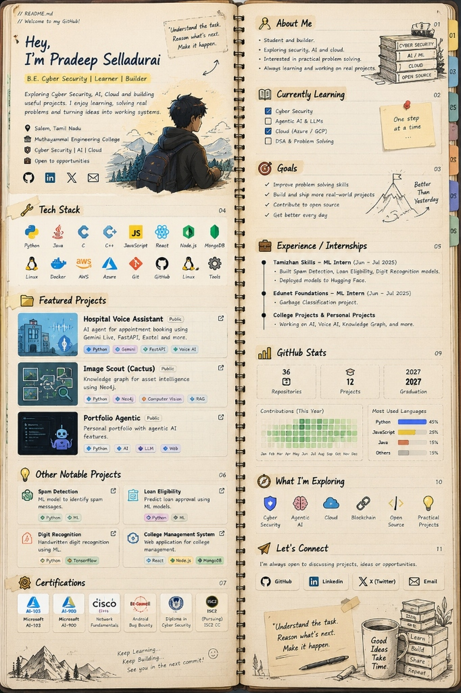
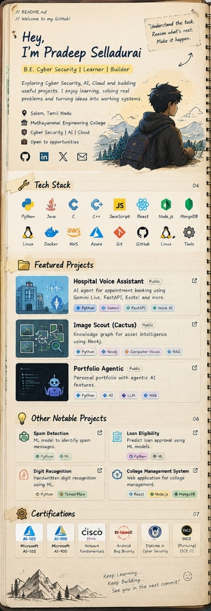
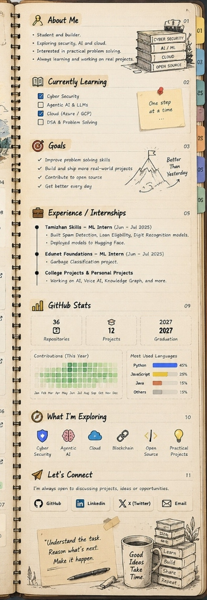

  

<b>📖 [Click to Zoom] View Left &amp; Right Pages in High Resolution</b>

 

  
  

---

### 📂 Quick Navigation &amp; Interactive Project Repositories

<table>
<tr>
<td width="50%" valign="top">

#### 🌟 Featured Projects

* 🏥 **[Hospital Voice Assistant](https://github.com/Cyberpradeep)** `Public`  
  AI agent for appointment booking using Gemini Live, FastAPI, Exotel, and real-time Voice AI.  
  `Python` · `Gemini Live` · `FastAPI` · `Voice AI`

* 🌵 **[Image Scout (Cactus)](https://github.com/Cyberpradeep)** `Public`  
  Knowledge graph for asset intelligence using Neo4j, computer vision, and hybrid RAG.  
  `Python` · `Neo4j` · `Computer Vision` · `RAG`

* 🤖 **[Portfolio Agentic](https://github.com/Cyberpradeep/portfolio_agentic)** `Public`  
  Personal portfolio demonstrating autonomous agentic features and deterministic execution layers.  
  `Python` · `Agentic AI` · `LLMs` · `FastAPI`

#### 💡 Other Notable Projects

* 🛡️ **[Spam Detection](https://github.com/Cyberpradeep)** — Machine learning pipeline to detect and classify spam text patterns.
* 📊 **[Loan Eligibility Predictor](https://github.com/Cyberpradeep)** — Predictive ML models determining loan underwriting criteria.
* ✍️ **[Digit Recognition](https://github.com/Cyberpradeep)** — Convolutional neural network recognizing handwritten digits in real-time.
* 🏫 **[College Management System](https://github.com/Cyberpradeep)** — Full-stack management portal built with React, Node.js, and MongoDB.

</td>
<td width="50%" valign="top">

#### 💼 Experience &amp; Internships

* 🏢 **Tamizhan Skills — ML Intern** *(Jun 2025 – Jul 2025)*  
  • Built &amp; trained spam classification, loan eligibility, and digit recognition ML models.  
  • Packaged and deployed inference pipelines to Hugging Face Spaces.

* 🏢 **Edunet Foundations — ML Intern** *(Jun 2025 – Jul 2025)*  
  • Computer vision pipeline for multi-class garbage detection &amp; classification.

* 🎓 **Muthayammal Engineering College** *(Batch 2023 – 2027)*  
  • B.E. Computer Science and Engineering (Cyber Security)  
  • Salem / Namakkal, Tamil Nadu, India

#### 🏆 Certifications &amp; Credentials

* 🏅 **Microsoft Certified:** Azure AI Engineer Associate (`AI-103`)
* 🏅 **Microsoft Certified:** Azure AI Fundamentals (`AI-900`)
* 🌐 **Cisco:** Network Fundamentals
* 🛡️ **EC-Council:** Android Bug Bounty Hunter
* 📜 **Diploma in Cyber Security**
* 🔒 **ISC2:** Certified in Cybersecurity (`CC`) *(Pursuing)*

</td>
</tr>
</table>

---

### 📬 Let's Connect

  
  
  
  

  <i>"Understand the task. Reason what's next. Make it happen."</i> 
  <i>Keep Learning... Keep Building... See you in the next commit! :)</i>

