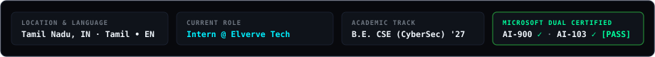
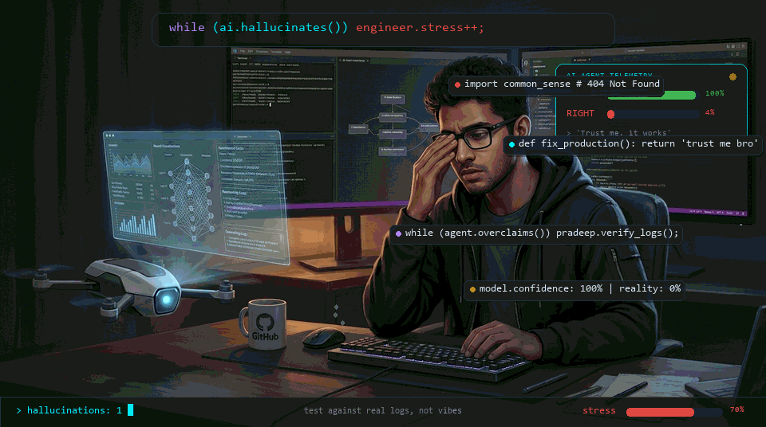
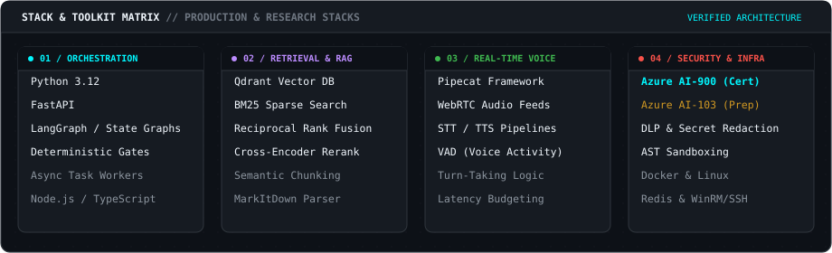

  

  

---

###  System Telemetry & Current Focus

  

---

###  Autonomous Agent Orchestration Graph

> Designing deterministic execution layers that fail *predictably*, rather than relying on unstructured model confidence.

  

---

###  Core Domain Architecture

  

---

###  Production Realities // Hallucination Defense

> *"The critical challenge in deploying generative AI into production systems isn't just failure — it's confident failure. My work focuses on building zero-trust sandboxes, AST security gates, and deterministic fail-safes so the system verifies against real logs before acting."*

  

---

###  Sharpened Production Toolkit

  

<b>▸ Inspect Granular Engineering &amp; Architectural Specifications</b>

 

| System Layer | Production Focus &amp; Tradeoff Verification |
| :--- | :--- |
| **Agent Orchestration** | LangGraph state machines, deterministic fallback routers, zero-trust bus protocols (`msg/1.0`), WinRM/SSH execution sandboxing |
| **Retrieval &amp; Search** | Qdrant vector storage, BM25 lexical sparse search, Reciprocal Rank Fusion (RRF), cross-encoder reranking, semantic layout parsing |
| **Real-Time Voice AI** | Pipecat orchestration, WebRTC duplex streams, STT/TTS latency budgeting (&lt;180ms), turn-taking models, VAD threshold calibration |
| **Cloud &amp; AI Platform** | Azure AI Foundry, Azure AI Services, automated DLP secret redaction, credential isolation boundaries |
| **Security &amp; Sandboxing** | AST static analysis, payload sanitization, zero-trust execution gates, audit-log provenance |
| **Infrastructure** | Docker containerization, Redis in-memory caches, Linux system administration, structured telemetry tracing |

---

###  Engineering Principles &amp; Mindset

> I don't trust an abstraction until I've broken it, inspected the logs, and traced *why* it failed.
> Theory first, then poke the running system until it stops lying to you.

  
  
  

---

###  Activity &amp; Commit Telemetry

  
  

  

---

###  Connect

  
  

  If you're exploring deterministic agent graphs, low-latency Voice AI, or zero-trust retrieval pipelines — let's connect. Open an issue or start a discussion.

