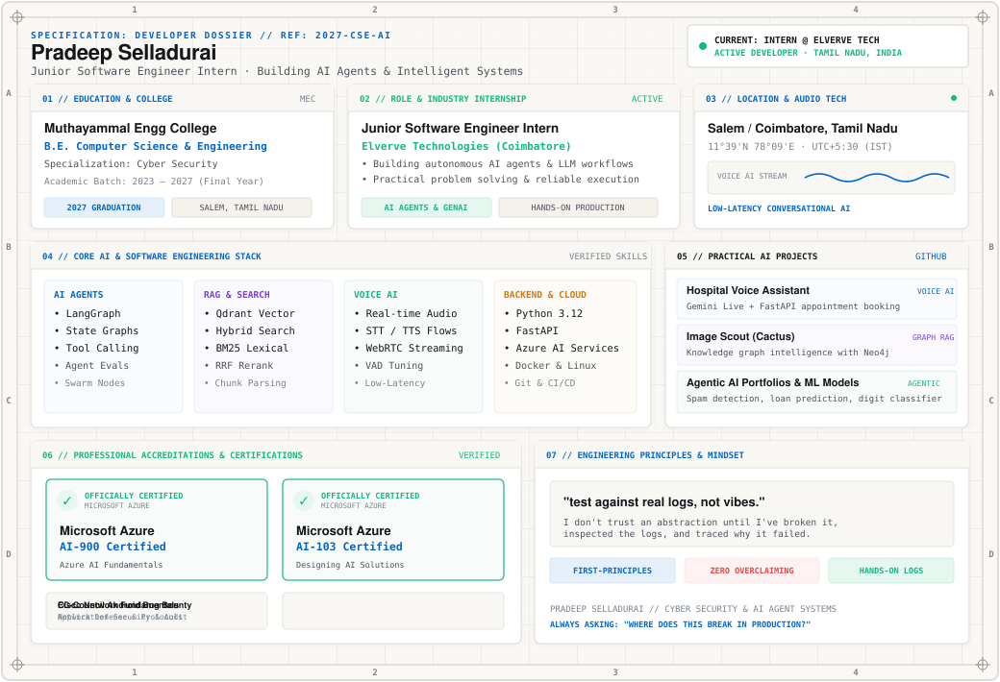

  

---

<b>📐 System Architecture &amp; Production Telemetry</b>

 

| Engineering Layer | Hardened Production Implementation &amp; Tolerances |
| :--- | :--- |
| **Agent Orchestration** | LangGraph state machines, deterministic fallback routers, zero-trust bus protocols (`msg/1.0`), WinRM/SSH execution sandboxes |
| **Zero-Trust Security** | AST static analysis, payload sanitization, automated DLP secret masking, credential isolation boundaries |
| **Retrieval &amp; Search** | Qdrant vector storage, BM25 lexical sparse search, Reciprocal Rank Fusion (RRF), cross-encoder reranking |
| **Real-Time Voice AI** | Pipecat orchestration, WebRTC duplex streams, STT/TTS latency budgeting (&lt;180ms), turn-taking models, VAD threshold tuning |
| **Cloud &amp; Platform** | Microsoft Azure AI Foundry, Docker containerization, Redis in-memory caching, Linux administration |

---

<b>📁 Verified Projects &amp; Repositories</b>

 

* **[Hospital Voice Assistant](https://github.com/Cyberpradeep)** — AI agent for automated appointment booking using Gemini Live, FastAPI &amp; Exotel. `Python` `Gemini` `FastAPI` `Voice AI`
* **[Image Scout (Cactus)](https://github.com/Cyberpradeep)** — Knowledge graph for asset intelligence using Neo4j and Computer Vision models. `Python` `Neo4j` `Vision` `RAG`
* **[Portfolio Agentic](https://github.com/Cyberpradeep)** — Personal portfolio platform demonstrating autonomous agentic AI execution. `Python` `Agentic AI` `LLM` `Web`
* **[Spam Detection](https://github.com/Cyberpradeep)** — Machine learning classification pipeline for automated spam detection. `Python` `ML`
* **[Loan Eligibility](https://github.com/Cyberpradeep)** — Predictive credit scoring and loan underwriting engine. `Python` `ML`
* **[Digit Recognition](https://github.com/Cyberpradeep)** — Deep learning convolutional handwritten digit classifier. `Python` `TensorFlow`
* **[College Management System](https://github.com/Cyberpradeep)** — Full-stack campus operations platform. `React` `Node.js` `MongoDB`

---

<b>📜 Professional Accreditations &amp; Credentials</b>

 

* **Microsoft Certified: Azure AI-103** — *Designing and Implementing an Azure AI Solution* `[PASS ✓]`
* **Microsoft Certified: Azure AI-900** — *Microsoft Azure AI Fundamentals* `[PASS ✓]`
* **Cisco Certified** — *Network Fundamentals &amp; Routing*
* **EC-Council Certified** — *Android Bug Bounty &amp; Mobile Security*
* **Diploma in Cyber Security** — *Network Defense &amp; Threat Analysis*
* **ISC2 Certified** — *Certified in Cybersecurity (CC)*

---

### ⚡ Activity Cadence

  

### 📬 Connect

  
  

"Understand the task. Reason what's next. Make it happen." — See you in the next commit! ☺

