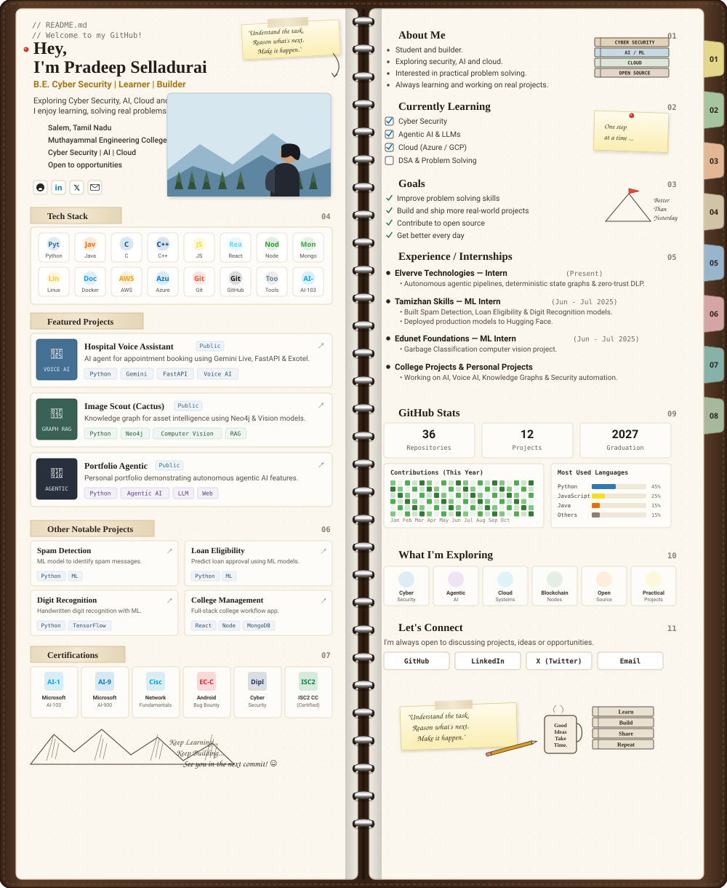

# 📓 Pradeep Selladurai — Engineering Notebook

  

---

<b>🔍 Click to Expand Direct Links, Repositories &amp; Credentials</b>

 

### 📁 Featured Projects
* **[Hospital Voice Assistant](https://github.com/Cyberpradeep)** — AI agent for appointment booking using Gemini Live, FastAPI, Exotel and more. `Python` `Gemini` `FastAPI` `Voice AI`
* **[Image Scout (Cactus)](https://github.com/Cyberpradeep)** — Knowledge graph for asset intelligence using Neo4j and Vision models. `Python` `Neo4j` `Computer Vision` `RAG`
* **[Portfolio Agentic](https://github.com/Cyberpradeep)** — Personal portfolio demonstrating autonomous agentic AI capabilities. `Python` `Agentic AI` `LLM` `Web`

### 💡 Other Notable Projects
* **[Spam Detection](https://github.com/Cyberpradeep)** — Machine learning model for automated spam classification. `Python` `ML`
* **[Loan Eligibility](https://github.com/Cyberpradeep)** — Predictive credit scoring and loan approval engine. `Python` `ML`
* **[Digit Recognition](https://github.com/Cyberpradeep)** — Handwritten digit classifier trained with deep learning. `Python` `TensorFlow`
* **[College Management System](https://github.com/Cyberpradeep)** — Full-stack workflow platform for campus administration. `React` `Node.js` `MongoDB`

### ⚙️ Certified Credentials
* **Microsoft Certified: Azure AI-103**
* **Microsoft Certified: Azure AI-900**
* **Cisco Network Fundamentals**
* **EC-Council Android Bug Bounty**
* **Diploma in Cyber Security**
* **ISC2 Certified in Cybersecurity (CC)**

### 🚀 Let's Connect
* **GitHub:** [@Cyberpradeep](https://github.com/Cyberpradeep)
* **Email:** [cyberpradeep@proton.me](mailto:cyberpradeep@proton.me)

  "Understand the task. Reason what's next. Make it happen." — See you in the next commit! ☺

