

<!-- HERO BANNER: TWILIGHT CHERRY GROVE REALM -->
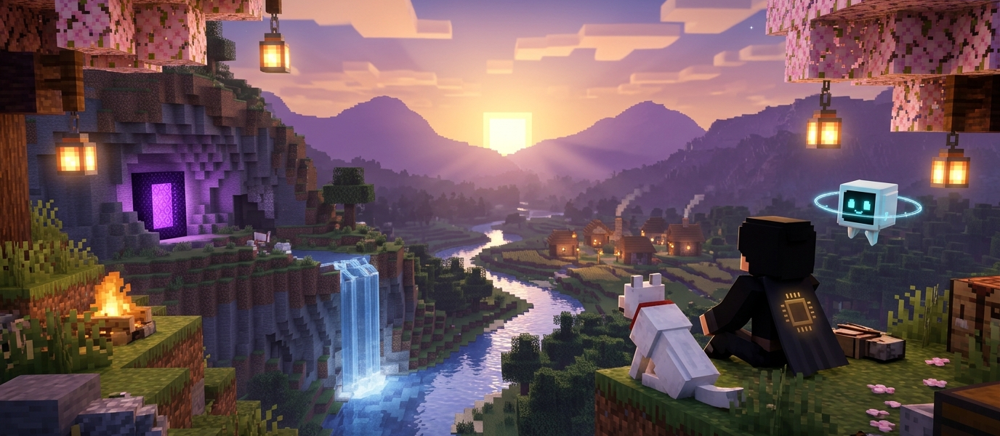

  

<!-- AUTHENTIC MINECRAFT CLEAN IN-GAME HUD -->
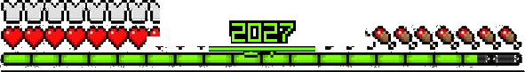

  

<!-- IN-GAME MINECRAFT CHAT MESSAGE BOX -->
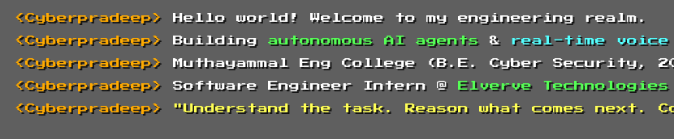

  

<!-- WORLD GAME MODE: CREATIVE -->
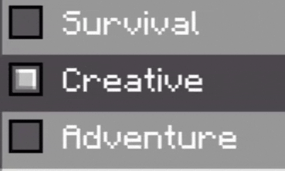

 

  

 

<!-- SECTION 1: SPAWN POINT & ENGINEERING LORE -->
<table width="100%" cellspacing="0" cellpadding="0" border="0">
  <tr>
    <td width="42%" valign="middle" align="center">
      
    </td>
    <td width="4%" valign="top"></td>
    <td width="54%" valign="middle">
      <h3>SPAWN POINT // THE ARCHITECT</h3>
      

        Building intelligent systems is a lot like laying redstone in Minecraft: if one repeater is off or a single wire loops back on itself, the whole contraption breaks.
      

      

        My focus is on creating <b>autonomous AI agents</b> that solve real tasks, <b>real-time voice assistants</b> that listen and speak as naturally as a phone call, and <b>bulletproof security</b> so the AI stays safely inside its sandbox.
      

      

        <i>"Understand the task. Reason what comes next. Commit the block."</i>
      

    </td>
  </tr>
</table>

 

  

 

<!-- SECTION 2: GUILD QUEST LOG & EDUCATION -->
<table width="100%" cellspacing="0" cellpadding="0" border="0">
  <tr>
    <td width="54%" valign="middle">
      <h3>GUILD LOG // ACADEMY &amp; FIELD EXPERIENCE</h3>
      

        Teaming up, leveling up skills, and turning fresh ideas into reliable, working software.
      

      <pre>
GUILD BASE   :: Muthayammal Engineering College (Rasipuram)
DEGREE       :: B.E. Computer Science &amp; Engineering (Cyber Security)
WORLD CYCLE  :: Batch 2023 — 2027 (Final Year)
COORDINATES  :: Salem, Tamil Nadu, India
ACTIVE ROLE  :: Junior Software Engineer Intern @ Elverve Technologies
SPECIALTY    :: Autonomous AI Agents, Gemini Live Voice, Zero-Trust Safety
      </pre>
    </td>
    <td width="4%" valign="top"></td>
    <td width="42%" valign="middle" align="center">
      
    </td>
  </tr>
</table>

 

  

 

<!-- SECTION 3: THE CRAFTING TABLE & INGREDIENTS -->

  <h3>THE CRAFTING TABLE // RECIPE FOR AN AUTONOMOUS AGENT</h3>
  
Combining core programming tools, voice streams, and security rules to craft a masterwork AI agent.

  
   
  
  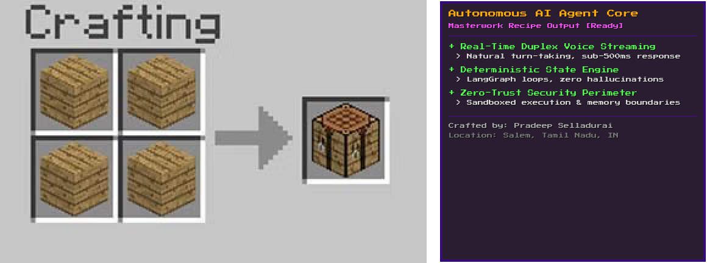

 

<table width="100%" cellspacing="0" cellpadding="0" border="0">
  <tr>
    <td width="38%" valign="middle" align="center">
      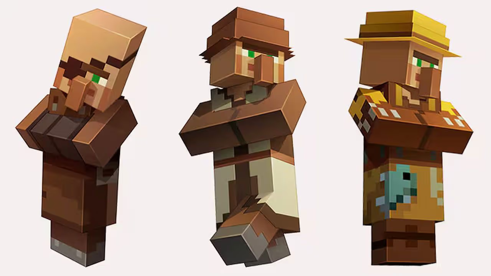
    </td>
    <td width="4%" valign="top"></td>
    <td width="58%" valign="middle">
      <h4>THE VILLAGER APPRAISAL</h4>
      

        <i>"Hrmmm... a solid recipe!"</i>
      

      

        Every slot in the grid has a clear purpose: <b>Python and FastAPI</b> run the engine, <b>Gemini Live</b> handles natural voice conversations, <b>LangGraph</b> keeps the agent on track, <b>Neo4j and Qdrant</b> provide memory, and <b>Zero-Trust Security</b> makes sure the agent only runs approved actions.
      

    </td>
  </tr>
</table>

 

  

 

<!-- SECTION 4: REDSTONE LOGIC & SOLVING AGENT PARADOXES -->
<table width="100%" cellspacing="0" cellpadding="0" border="0">
  <tr>
    <td width="42%" valign="middle" align="center">
      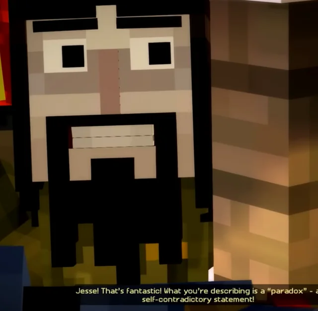
    </td>
    <td width="4%" valign="top"></td>
    <td width="54%" valign="middle">
      <h3>REDSTONE LOGIC // SOLVING AGENT PARADOXES</h3>
      

        When AI agents run autonomously, they can easily get stuck in circular logic loops or hallucinate self-contradictory answers.
      

      

        To prevent this, I design systems with <b>deterministic state machines</b> (like a clean redstone clock). The agent is given strict checkpoints: every action is verified, tool outputs are double-checked, and paradoxes are caught before they ever reach production.
      

    </td>
  </tr>
</table>

 

  

 

<!-- SECTION 5: SIGNATURE BUILDS & CODEBASE INSPECTION -->
<table width="100%" cellspacing="0" cellpadding="0" border="0">
  <tr>
    <td width="58%" valign="middle">
      <h3>SIGNATURE BUILDS // EXPLORE THE CODE</h3>
      

        Every build is crafted to solve a real challenge in the real world:
      

      <ul>
        <li>
          <b>Hospital Voice Assistant</b>: A real-time voice AI agent for hospital appointment scheduling and patient routing. It listens and speaks simultaneously with sub-500ms delay, letting callers interrupt naturally just like talking to a real person.
           
          <code>Python</code> <code>Gemini Live</code> <code>FastAPI</code> <code>WebRTC</code> <code>Exotel</code>
           
          <a href="https://github.com/Cyberpradeep"><code>[INSPECT CODEBASE]</code></a>
        </li>
         
        <li>
          <b>Image Scout (Cactus Engine)</b>: A knowledge graph engine that connects visual assets and complex questions into a searchable web of relationships using Neo4j and vector search.
           
          <code>Python</code> <code>Neo4j</code> <code>Computer Vision</code> <code>Vector Search</code>
           
          <a href="https://github.com/Cyberpradeep"><code>[INSPECT CODEBASE]</code></a>
        </li>
         
        <li>
          <b>Portfolio Agentic Core</b>: An interactive portfolio powered by a live AI execution loop that answers questions, queries projects, and inspects its own environment safely.
           
          <code>Python</code> <code>LangGraph</code> <code>FastAPI</code> <code>Agentic AI</code>
           
          <a href="https://github.com/Cyberpradeep"><code>[INSPECT CODEBASE]</code></a>
        </li>
      </ul>
    </td>
    <td width="4%" valign="top"></td>
    <td width="38%" valign="middle" align="center">
      
       
      <code>LUKAS: "CHECKING THE REPO COMMIT LOGS..."</code>
    </td>
  </tr>
</table>

 

  

 

<!-- SECTION 6: DEFENDING THE VILLAGE (SECURITY & PERIMETER DEFENSE) -->
<table width="100%" cellspacing="0" cellpadding="0" border="0">
  <tr>
    <td width="42%" valign="middle" align="center">
      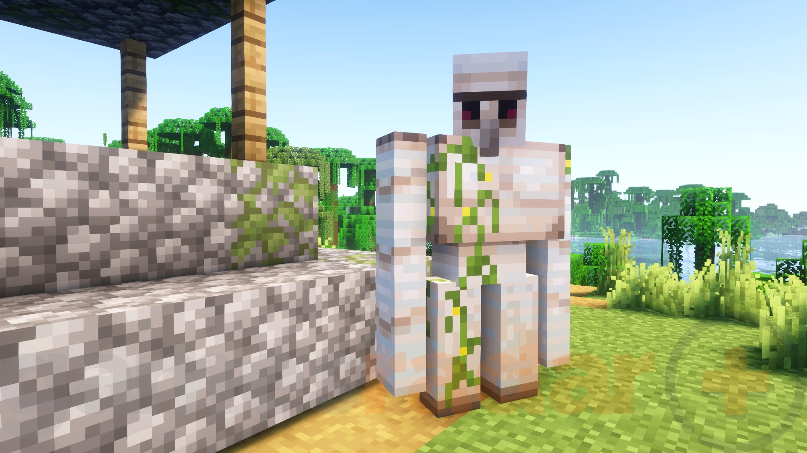
        
      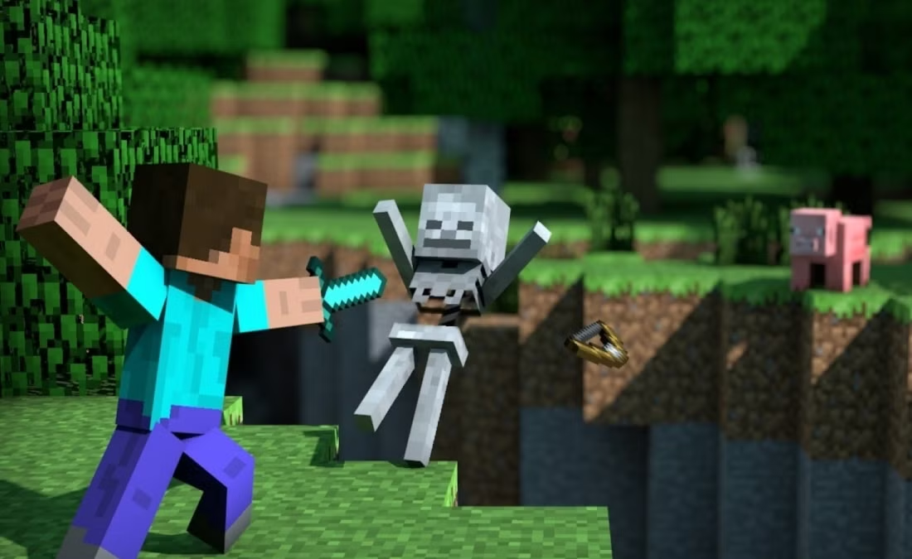
    </td>
    <td width="4%" valign="top"></td>
    <td width="54%" valign="middle">
      <h3>DEFENDING THE VILLAGE // PERIMETER SECURITY</h3>
      

        Just like keeping skeletons and creepers out of your base at night, an AI application must be protected from malicious prompts, unauthorized access, and unexpected inputs.
      

      <pre>
HOSTILE THREATS STRUCK DOWN:
[x] Malicious Prompt Injections &amp; Tricky Prompts
[x] Unauthorized Tool Calls &amp; Privilege Escalation
[x] Unsafe Code Execution &amp; Grammar Hijacking
[x] Memory Leaks &amp; State Boundary Breaches

DEFENSE MECHANISMS IN ACTION:
[ACTIVE] Zero-Trust Sandboxes: AI tools run with limited rights
[ACTIVE] Static Code Verification: Code is checked before running
[ACTIVE] Hardened Network Routing: Cisco-grade traffic protection
      </pre>
      

        Like an <b>Iron Golem</b> on watch, the security boundary keeps the system stable and trustworthy 24/7.
      

    </td>
  </tr>
</table>

 

  

 

<!-- SECTION 7: ENCHANTED ACCREDITATIONS & HONEST REACTION -->
<table width="100%" cellspacing="0" cellpadding="0" border="0">
  <tr>
    <td width="58%" valign="middle">
      <h3>ENCHANTED ACHIEVEMENTS // VERIFIED CREDENTIALS</h3>
      

        Passing industry-recognized certifications with first-principles understanding:
      

      <pre>
[PASS] Microsoft Certified: Azure AI Solutions (AI-103)
[PASS] Microsoft Certified: Azure AI Fundamentals (AI-900)
[PASS] Cisco Certified: Network Fundamentals &amp; Routing
      </pre>
      

        Hardened through real labs, practical challenges, and verified exams.
      

    </td>
    <td width="4%" valign="top"></td>
    <td width="38%" valign="middle" align="center">
      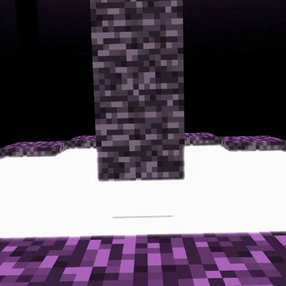
       
      <code>FINAL BOSS DEFEATED // VERIFIED CREDENTIALS UNLOCKED</code>
    </td>
  </tr>
</table>

 

  

 

<!-- SECTION 8: MULTIPLAYER LOBBY (CONNECT & INVENTORY HOTBAR) -->

  <h3>MULTIPLAYER LOBBY // CONNECT &amp; COLLABORATE</h3>
  
Ready to team up on AI agents, real-time voice streaming, or systems security? Select a slot to connect!

  
  
  
    
  
  <!-- AUTHENTIC MINECRAFT EQUIPPED HOTBAR -->
  
  
    
  
  <!-- INTERACTIVE INVENTORY SLOTS -->
  <table border="0" cellspacing="8" cellpadding="0" align="center">
    <tr>
      <td align="center">
        <a href="https://github.com/Cyberpradeep" target="_blank">
          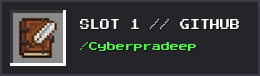
        </a>
      </td>
      <td align="center">
        <a href="https://www.linkedin.com/in/pradeepselladurai/" target="_blank">
          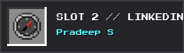
        </a>
      </td>
      <td align="center">
        <a href="https://pradeepselladurai.me" target="_blank">
          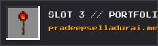
        </a>
      </td>
      <td align="center">
        <a href="mailto:pradeepnaveen930@gmail.com" target="_blank">
          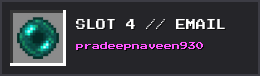
        </a>
      </td>
    </tr>
  </table>

